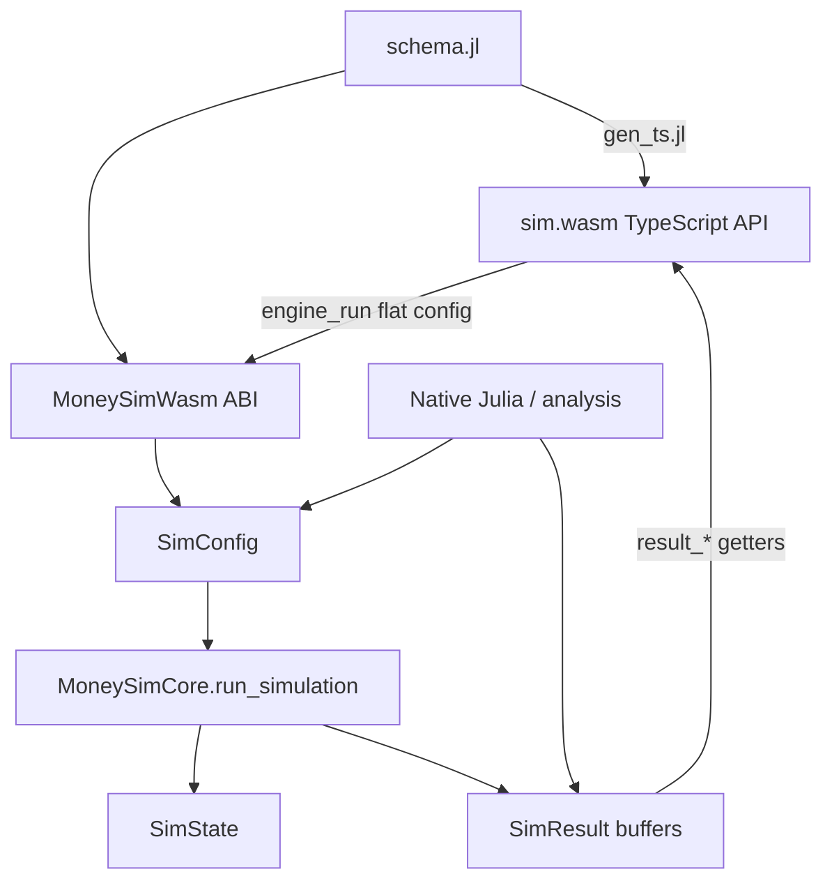

# WASM-Ready Simulation Core

- **Status:** Draft
- **Date:** 2026-10-21
- **Repos:** `EconoSim.jl`, `MoneySim.jl`, `sim.wasm`
- **Related:** `sim.wasm/README.md`, `EconoSim.jl/README.md`

## 1. Summary

`sim.wasm` currently works because it carries a second, hand-maintained copy of
the simulation engine in `sim.wasm/julia/`. That copy has drifted from the
packages that own the economics, and it must be kept in sync by hand.

This plan makes `EconoSim.jl` and `MoneySim.jl` themselves WASM-ready, so that
`sim.wasm` can depend on them directly:

- extract a dependency-free **`EconoSimCore`** package (money, ledgers, SuMSy,
  debt, RNG);
- extract **`MoneySimCore`** (population, money models, transactions, taxes,
  government, metrics, orchestration) on top of it;
- move the wasm ABI and TypeScript schema into a small **`MoneySimWasm`**
  package;
- delete `sim.wasm/julia/` entirely.

The existing `EconoSim`/`MoneySim` APIs remain available as adapters over the
core. There is one engine, two frontends (native Julia + wasm).

### Hard constraint

> **Do not copy or adapt code from `sim.wasm/julia/`.** That directory is
> deleted, not migrated. The upstream packages are the source of truth. Where
> a feature exists only in that directory (notably the loan circuit), it must be
> designed/ported from the upstream economic specification, not lifted.

## 2. Context

### 2.1 Why the current structure exists

MoneySim’s full `run_simulation` orchestration (Agents.jl / DataFrames /
`FixedPointDecimals.Currency`) does not compile to WebAssembly. Two findings
drove the current workaround:

- `FixedDecimal{Int128,4}` construction cannot lower to wasm (its inner
  `throw_inexact` closure is not compilable), though its arithmetic can.
  `Int128` division is also unsupported by the wasm backend.
- WasmGC arrays have no JS-facing allocation bridge, so state lives inside the
  wasm module and is accessed through scalar getters/setters.

The response was to reimplement the engine in `sim.wasm/julia/` with integer
fixed-point money and an internal state array. That solved the build, but
created a parallel implementation that is now the de facto upstream.

### 2.2 Why it cannot be used from the packages today

WasmTarget compiles the reachable, fully type-inferred call graph. It rejects
constructs whose inferred type is abstract, and it can only compile code whose
dependencies load and expand in the build environment. The packages violate
both in several ways (see §5).

## 3. Goals

1. A zero-dependency Julia core that compiles to a single import-free WasmGC
   module.
2. Native and wasm runs of the same configuration produce the same results.
3. The wasm ABI and its TypeScript surface are generated from one upstream
   schema, not hand-maintained in `sim.wasm`.
4. `sim.wasm/julia/` can be deleted without losing functionality.
5. The existing `MoneySim`/`EconoSim` API keeps working for analysis and
   research users.

### Non-goals

- Compiling Agents.jl, DataFrames, Plots, or the production module to wasm.
- Preserving in-memory type identity of `FixedDecimal`-based currencies.
- Byte-for-byte seed compatibility with the current engine (see §10).
- Implementing the browser demo/UI; that stays in `sim.wasm`.

## 4. Success criteria

- [ ] `sim.wasm/julia/` is deleted.
- [ ] `npm test` passes in `sim.wasm` against a freshly built `ecosim.wasm`.
- [ ] `npm run build:wasm` succeeds from a clean checkout with Julia 1.12+
      and WasmTarget.
- [ ] Native `MoneySimCore.run_simulation(cfg)` and wasm results match on the
      parity matrix (§9.2), exactly or within a documented rounding tolerance.
- [ ] No reachable code in the core uses `Any`, `Function` values, runtime
      `Type`, `Dict{Symbol,Any}`, or `FixedDecimal` construction.
- [ ] The wasm module has no imports (`WebAssembly.instantiate(bytes)` works
      without an imports object).
- [ ] `MoneySim` analysis API (DataFrames results, plotting) still works.

## 5. Current blockers

Line references are approximate as of 2026-10-21; use the symbol names.

| # | Blocker | Evidence | Required change |
|---|---|---|---|
| B1 | `Currency = FixedDecimal{Int128,4}` construction cannot lower; Int128 division unsupported | `EconoSim.jl/src/utilities/types.jl` (`Currency`, `Fixed`); `finance/*` | Int64 fixed-point `Money` type in the core |
| B2 | Global `Currency` binding reassigned at runtime | `utilities/functions.jl` (`set_currency_precision!`) | Delete; compile-time constant |
| B3 | Abstract `ABM` / `AbstractActor` signatures throughout | `MoneySim.jl/src/simulations.jl`, `money_models.jl`, `transaction_models.jl`, `tax_scheme.jl`, `population.jl` | Core operates on concrete `SimState` |
| B4 | `Vector{Function}` behaviors | `EconoSim.jl/src/actors/actor.jl`, `models/econo_model.jl` | `@enum Behavior` + explicit dispatch |
| B5 | `Dict{Symbol,Any}` property bags and `getproperty` overrides | `actors/actor.jl`, `finance/balance.jl`, `finance/single_sumsy_balance.jl` | Concrete struct fields |
| B6 | Function-valued configuration | `money_models.jl` (`FixedWealthParams`, `StandardSuMSyParams`), `transaction_models.jl` (yard-sale params), `tax_scheme.jl` (`StateTaxScheme`), `data_handler.jl` | Numeric config + enums; precomputed brackets |
| B7 | `UUIDs` in core types | `finance/balance.jl` (`BalanceEntry`), `finance/debt.jl` (`Debt`) | Int32/Int64 entry ids; deterministic counters |
| B8 | `Intervals.jl` tier ranges | `finance/sumsy.jl` (`DemTiers`) | Two integer vectors (uppers, rates) |
| B9 | Global RNG, `time()`, `uuid4()` | `simulations.jl` (`set_random_seed!`), `transaction_models.jl`, `money_models.jl` | Explicit `Rng` passed through; seed in config |
| B10 | Mutable global country registry, `Dict{Symbol,…}` data | `country_simulations/country_data.jl` | Immutable data, typed fields, pure accessors |
| B11 | Runtime `Type` parameter | `models/econo_model.jl` (`create_econo_model`) | Concrete constructors only |
| B12 | DataFrames/Plots/Infiltrator loaded by the main module | `MoneySim.jl/src/MoneySim.jl`, `behaviors.jl`, `keynes_sim.jl`, `data_handler*.jl` | Move to analysis layer |
| B13 | Strings in reachable code | `tax_scheme.jl` (`printable`, `model.tax_scale *= ...`) | Remove; keep the wasm module import-free |

## 6. Target architecture

### 6.1 Package layout

```
EconoSim.jl/
  core/                      # NEW package: EconoSimCore (zero deps)
    Project.toml
    src/EconoSimCore.jl
    src/money.jl             # Money (Int64 × 10^4), permyriad helpers
    src/entries.jl           # entry ids, concrete Balance
    src/sumsy.jl             # GI, demurrage tiers (integer)
    src/debt.jl              # loans, repayment
    src/rng.jl               # explicit deterministic RNG
    test/runtests.jl
  src/                       # existing Agents/DataFrames-facing API
    ...
  src/production/            # unchanged; stays out of wasm

MoneySim.jl/
  core/                      # NEW package: MoneySimCore (dep: EconoSimCore)
    Project.toml
    src/MoneySimCore.jl
    src/state.jl             # SimState: concrete SoA arrays
    src/config.jl            # SimConfig: plain struct, enums, seeds
    src/population.jl
    src/money_models.jl      # SUMSY, debt-based, loan circuit
    src/transactions.jl      # yard sale, GDP yard sale
    src/taxes.jl
    src/government.jl
    src/adaptations.jl
    src/country_data.jl      # immutable data + pure derivation
    src/metrics.jl           # gini, shares, income gini
    src/run.jl               # run_simulation(cfg) -> SimResult
    test/runtests.jl
  wasm/                      # NEW package: MoneySimWasm
    Project.toml             # deps: MoneySimCore, WasmTarget
    src/MoneySimWasm.jl
    src/abi.jl               # engine_*, result_*, bv_*
    src/schema.jl            # single source of truth for config + ABI
    build.jl                 # compile_multi(...) -> ecosim.wasm
    gen_ts.jl                # render sim.wasm/src/generated/*
  src/                       # existing API + analysis
  src/plotting.jl            # analysis only
  src/data_analysis.jl       # analysis only

sim.wasm/
  src/generated/             # generated by MoneySim.jl/wasm/gen_ts.jl
  prebuilt/ecosim.wasm       # produced by MoneySim.jl/wasm/build.jl
  (julia/ deleted)
```

Core and wasm are **separate packages**, not submodules, so the build project
never loads Agents.jl, DataFrames, or Plots.

### 6.2 Data flow



### 6.3 Numeric contract

- **Money:** `Int64`, scaled by `10^4` (currency × 10,000).
- **Rates:** `Int64` permyriad (rate × 10,000).
- **Probability weights:** `Float64` only where they are genuine probabilities
  (yard-sale direction / wealth advantage).
- **Flags:** `UInt8` (`0`/`1`) in state arrays; avoid `BitVector` and arrays of
  `Bool`.
- **Rounding:** explicit and documented (see §12.2). Do not rely on implicit
  Float→Int truncation.
- **Overflow:** use the overflow-safe permyriad helper; document the maximum
  representable amount (≈ 9.22e14 currency).

### 6.4 Config representation and readability

There are three representations. Only the runtime one is compiled to wasm.

**Authoring (TypeScript)** — string unions, not numeric `enum`s:

```ts
export const MoneyModels = {
  sumsy: 1,
  debtBased: 2,
  loanCircuit: 3,
} as const;
export type MoneyModel = keyof typeof MoneyModels; // "sumsy" | "debtBased" | "loanCircuit"

export interface MoneyConfig {
  model: MoneyModel;
  guaranteedIncome: number;
  demurrageRate: number;
  demurrageFree: number;
  interestRate: number;
}
```

**Wire (JS → wasm)** — a slot block generated from `schema.jl`. Codes are
explicit, stable, and never reused. JavaScript never sees the codes.

**Runtime (Julia)** — nested immutable structs with named enums. Prefer full
words over abbreviations; field names are documentation:

```julia
module MoneyModel
    @enum Kind::Int32 SUMSY = 1 DEBT_BASED = 2 LOAN_CIRCUIT = 3
end

module TaxKind
    @enum Kind::Int32 NO_TAX = 0 WEALTH = 1 INCOME = 2 DEMURRAGE = 3
end

module TaxRecipient
    @enum Kind::Int32 EVERYONE = 0 ONE_ACTOR = 1 DESTROY = 2 FIRST_N = 3
end

struct MoneyConfig
    model::MoneyModel.Kind
    guaranteed_income::Int64
    demurrage_rate::Int64
    demurrage_free::Int64
    interest_rate::Int64
end

struct TaxConfig
    kind::TaxKind.Kind
    rate::Int64
    interval::Int
    target_revenue::Int64
    recipients::TaxRecipient.Kind
    recipient_actor::Int
    bracket_uppers::Vector{Int64}
    bracket_rates::Vector{Int64}
end

struct BankConfig
    enabled::Bool
    actor_index::Int
    repayment_rate::Int64
    lending_amount::Int64
    lending_targets::Int
    mode::BankMode.Kind
end

struct TransactionConfig
    model::TransactionModel.Kind
    transfer_rate::Int64
    minimal_transfer::Int64
    wealth_advantage::Float64
    transactions_per_period::Int
    allow_negative::Bool
end

struct SimConfig
    periods::Int
    seed::UInt64
    actor_count::Int
    initial_wealth::Int64
    money::MoneyConfig
    bank::BankConfig
    transactions::TransactionConfig
    tax::TaxConfig
    population::PopulationConfig
    government::GovernmentConfig
    gdp::GdpConfig
    adaptations::AdaptationConfig
end
```

`SimConfig` stays a flat list of *nested concerns*, not a flat list of 60
fields. Each sub-config uses the same pattern and has an `enabled` flag where
the feature is optional.

Call sites read as `MoneyModel.SUMSY`, `TaxKind.INCOME`,
`TaxRecipient.EVERYONE` — no magic integers.

Validation note: prove enum lowering with the wasm smoke test. If a given
Julia/WasmTarget version cannot lower `@enum`, keep the same qualified names
as `const Int32` values behind the module (`MoneyModel.SUMSY = Int32(1)`) so
call sites and the schema do not change.

Readability rules:

- Full words in field names: `demurrage_permyriad`, not `dem_pm`.
- One nested struct per concern; no 60-field flat struct.
- `enabled::Bool` + zeroed fields instead of `Union{Nothing,T}`.
- Enum values live in small modules so they are always qualified.
- `schema.jl` carries the display name and doc string for each field;
  `gen_ts.jl` emits the same name/doc into TypeScript.
- Never expose enum codes in the TS authoring API.

If you prefer no `@enum` at all, the alternative is one struct per variant
(`SUMSYConfig`, `DebtBasedConfig`, `LoanCircuitConfig`) plus a parametric
`SimConfig{M<:MoneyConfig}` and a single ABI branch that constructs the
concrete type. It is equally concrete and readable, but multiplies type
parameters across variant dimensions (`money`, `tax`, `population`) and
requires more branching in the ABI. Keep this as a fallback, not the default.

## 7. Workstreams

### WS1 — `EconoSimCore` (owner: EconoSim.jl)

- [x] Create `EconoSim.jl/core/` package with UUID and zero dependencies.
- [x] Implement `Money` (`Int64` × 10^4) with `+`, `-`, `<`, `==`, `zero`,
      `typemin`, `typemax`, `money(::Real)`, `currency(::Money)`.
- [x] Implement `apply_rate(::Money, ::Int64)` with overflow-safe division.
- [x] Replace `Percentage` in core paths with permyriad `Int64`; the core has
      no `Percentage` type at all.
- [x] Core has no `set_currency_precision!` or mutable `CUR_MAX`/`CUR_MIN`/
      `CUR_0` globals (root migration still pending).
- [x] Replace `BalanceEntry` (UUID + Symbol) with `@enum Entry::Int32`.
- [x] Replace `Balance` dictionaries with fixed `Vector{Money}` arrays indexed
      by entry id; no `properties` or `getproperty` overrides.
- [x] Replace `DemTiers = Vector{Tuple{Interval, Percentage}}` with integer
      `spans`/`rates`; no `Intervals` or `DataStructures`.
- [x] Rewrite `calculate_time_range_demurrage`,
      `calculate_adjustments`, `telo`, `calculate_sumsy_deposit` with integer
      arithmetic.
- [x] Remove the `Debt.id::UUID` field from the core type.
- [x] Add explicit `Rng` (`UInt64` state; `next_u64!`, `rand_index`,
      `rand_unit`) and thread it through the core API.
- [x] Add `core/test/wasm_smoke.jl` that compiles a SuMSy kernel with
      WasmTarget.
- [x] Port unit tests (90 passing).
- [ ] Add a rounding corpus against `FixedPointDecimals` (the core uses
      integer truncation; parity is checked by tolerance in the paper suite).

**Exit criteria:** `EconoSimCore` has no external deps, and a SuMSy
balance can be simulated for N periods under `compile(...)`.

### WS2 — `MoneySimCore` (owner: MoneySim.jl)

- [ ] Create `MoneySim.jl/core/` package depending only on `EconoSimCore`.
- [ ] Define `SimState` (SoA) and `ResultBuffers`.
- [ ] Define `SimConfig` as nested immutable structs (`MoneyConfig`,
      `BankConfig`, `TaxConfig`, `PopulationConfig`, `GovernmentConfig`,
      `GdpConfig`, `AdaptationConfig`, `TransactionConfig`). Use named,
      qualified enums (`MoneyModel.SUMSY`, `TaxKind.INCOME`,
      `TaxRecipient.EVERYONE`), not bare integer codes. See §6.4.
- [ ] Follow the readability rules in §6.4: full-word field names, one nested
      struct per concern, `enabled::Bool` instead of `Union{Nothing,T}`.
- [ ] Implement population initialization and dynamics on `SimState`.
- [ ] Implement money models: SUMSY, debt-based/bank, loan circuit (see §11.3).
- [ ] Implement transactions: standard yard sale, GDP yard sale.
- [ ] Implement taxes: wealth levy, progressive income, demurrage tax, VAT
      (if required), recipients (`all`, `actor`, `destroy`, `first N`).
- [ ] Implement government/deficit spending and public-debt ledger.
- [ ] Implement GDP volume target and growth.
- [ ] Implement money injection/destruction adaptations.
- [ ] Implement metrics: Gini, mean/total/min/max, cumulative shares, income
      Gini, tax scale.
- [ ] Implement `run_simulation(cfg::SimConfig, state::SimState)::SimResult`.
- [ ] Remove all `ABM`, `allagents`, `nagents`, `abmproperties`, `random_agent`
      calls from the core path.
- [ ] Remove all `Vector{Function}` behavior plumbing from the core path.
- [ ] Replace `Dict{Symbol,…}` population/type/sumsy-group structures with
      typed fields or vectors.
- [ ] Add native tests and a wasm smoke run.

**Exit criteria:** SUMSY + yard sale + wealth tax runs natively and under
`compile_multi`, producing matching aggregates.

### WS3 — `MoneySimWasm` (owner: MoneySim.jl + sim.wasm)

- [ ] Create `MoneySim.jl/wasm/` package (deps: `MoneySimCore`, `WasmTarget`).
- [ ] Add a single `const STATE = SimState()` and all `engine_*` accessors.
- [ ] Keep export names compatible with the current TS surface:
      `engine_alloc`, `engine_execute`, `engine_run`, `engine_set_*`,
      `engine_*` getters, `result_*`, `bv_i64_*`.
- [ ] Add `schema.jl` describing:
      - entry points and Julia signatures;
      - config slots, display names, docs, defaults, and stable codes;
      - TS parameter/return types (string unions for enums, not numeric
        `enum`s).
- [ ] Make `gen_ts.jl` emit the authoring surface from that schema, including
      the string-union types and the `as const` code maps. Hand-written TS
      must never contain enum codes.
- [ ] Generate `sim.wasm/src/generated/config.ts` and `engine-abi.ts` from the
      schema (`gen_ts.jl`).
- [ ] Add `build.jl` that calls
      `compile_multi(MoneySimWasm.wasm_entries(); optimize=true)` and writes
      the output path.
- [ ] Update `sim.wasm/package.json`:
      ```json
      "build:wasm": "julia --project=../MoneySim.jl/wasm ../MoneySim.jl/wasm/build.jl --out=prebuilt/ecosim.wasm",
      "gen": "julia --project=../MoneySim.jl/wasm ../MoneySim.jl/wasm/gen_ts.jl --out=src/generated"
      ```
- [ ] Verify the emitted module has no imports (no strings/printing reachable).
- [ ] Delete `sim.wasm/julia/`.
- [ ] Update `sim.wasm/README.md` and package scripts to point upstream.

**Exit criteria:** `npm test` passes in `sim.wasm` with no `julia/` directory.

### WS4 — Legacy adapter and analysis split (owner: both packages)

- [ ] Keep `EconoSim` (Agents.jl) and `MoneySim` (ABM keyword API) as thin
      adapters that build a `SimConfig`/`SimState` and call the core.
- [ ] Move DataFrames collection/assembly to `src/data_analysis.jl` or a
      `MoneySimAnalysis` package.
- [ ] Move Plots/PlotlyJS/StatsPlots/CSV/CSV-related code to the analysis
      layer or package extensions.
- [ ] Remove `using Infiltrator` and any `@infiltrate` calls.
- [ ] Remove `Todo`, `PkgAuthentication`, `Revise`, `Lazy` from runtime deps.
- [ ] Maintain `simulate_country` as `country_config(...) |> run_simulation |> analyze`.
- [ ] Add deprecation shims for `Currency`, `BalanceEntry`, and old keyword
      arguments where feasible.

**Exit criteria:** existing tests for analysis/plotting pass; core tests do not
load any analysis dependency.

### WS5 — Country data (owner: MoneySim.jl)

- [ ] Make `PopulationData` concrete (`min18`, `age18to64`, `age65plus`).
- [ ] Make `SuMSyData.sumsy_groups` concrete (three typed pairs).
- [ ] Replace `COUNTRY_DATA::Dict` with immutable `const` values and accessors
      that take `CountryData` explicitly.
- [ ] Split `simulate_country` into:
      - `country_config(country; kwargs...)::SimConfig`;
      - `run_simulation(cfg)::SimResult`;
      - `simulate_country(...)` analysis wrapper.
- [ ] Decide whether country presets are compiled into wasm or passed from TS
      (see §11.4). If compiled in: expose `engine_country_config(id, ...)`.
- [ ] Make `sim.wasm/src/country.ts` a thin wrapper or generate its preset data
      from the Julia source.

**Exit criteria:** no duplicated Belgian/NL data or derivation rules between
Julia and TypeScript.

### WS6 — Testing and CI (owner: sim.wasm + both packages)

- [x] Implement the paper suite described in §9: `scenarios.jl`, `paper1.jl`,
      `paper2.jl`, `paper3.jl`, `run.jl` (baseline capture still pending).
- [ ] Record golden fixtures from the current implementation **before** the
      refactor (see §9.2).
- [ ] Add native↔wasm parity tests for the matrix in §9.8.
- [ ] Add the invariant/property tests in §9.7.
- [ ] Add a CI job that:
      - compiles the wasm;
      - runs `sim.wasm` Node tests against the fresh artifact;
      - runs native parity;
      - runs `PAPER_TESTS=fast`, with `full` nightly;
      - optionally runs JET/`@check_allocs` on the core.
- [ ] Add a lint/CI check that `sim.wasm/julia/` stays deleted.
- [ ] Add a CI check that the wasm module has no imports.

## 8. Delivery phases

### Phase 0 — Freeze behavior

- [x] Implement `MoneySim.jl/test/papers/scenarios.jl` from §9.3–9.5.
- [x] Implement the paper 1/2/3 tests (baseline capture still pending).
- [ ] Capture the baseline for all current scenarios and store it in
      `MoneySim.jl/test/papers/fixtures/baseline.json`.
- [ ] Record the current `prebuilt/ecosim.wasm` outputs for the same scenarios
      in `sim.wasm/test/fixtures/`.

**Exit:** a failing test exists if either the native or wasm numbers drift, and
the paper 1/2/3 targets are encoded in CI.

### Phase 1 — `EconoSimCore`

- [x] WS1 tasks.
- [x] Native unit tests pass (90).
- [x] Wasm compile smoke test passes (33 KB module, import-free, native result
      `191235851` matches in Node).

**Exit:** money, balance, SuMSy, debt, RNG compile to wasm in isolation.

### Phase 2 — `MoneySimCore` minimal path

- [ ] WS2 state/config/population.
- [ ] SUMSY + yard sale + wealth tax + metrics + `run_simulation`.
- [ ] Native tests pass.
- [ ] Wasm smoke compile and run.

**Exit:** one scenario runs end-to-end from a `SimConfig`.

### Phase 3 — ABI cutover

- [ ] WS3 tasks.
- [ ] Generate TS from the schema.
- [ ] Point `sim.wasm` scripts upstream.
- [ ] Delete `sim.wasm/julia/`.
- [ ] Golden fixtures pass.

**Exit:** `npm test` green without `julia/`.

### Phase 4 — Feature parity

- [ ] Income tax / brackets / target revenue.
- [ ] Demographics (birth, death, aging, GI by type).
- [ ] Government / deficit / public debt.
- [ ] GDP volume target and growth.
- [ ] Money injection/destruction.
- [ ] SUMSY demurrage-free buffer.
- [ ] Post-Keynesian bank.
- [ ] Loan circuit (see §11.3).

**Exit:** full parity matrix green.

### Phase 5 — Country and analysis split

- [ ] WS5 tasks.
- [ ] WS4 analysis split and deprecations.

**Exit:** no duplicated country data; core has no analysis deps.

### Phase 6 — Ratchet

- [ ] CI enforces compile + parity on every PR.
- [ ] Document the ABI/schema workflow.
- [ ] Remove transitional code and aliases.

## 9. Paper-based regression suite

The papers in `MoneySim.jl/jupyter/` are the external oracle for the refactor.
They give us three independent kinds of check:

1. **Closed-form results** (paper 1) that must match exactly.
2. **Analytic bounds and long-run equilibria** (paper 2) that the simulation
   must respect.
3. **Full reference series** (paper 3) generated by the current implementation
   and committed as CSV.

Together with a captured baseline snapshot, these let us compare “before” and
“after” numerically, not just structurally.

### 9.1 Test layers

| Layer | Purpose | Runs in PR CI |
|---|---|---|
| Formula/unit | Money, demurrage, telo, tax brackets, Gini | yes |
| Paper 1 | Exact debt-ratio / growth-ratio values | yes |
| Paper 2 | Scenario equilibria and bounds | yes (fast subset) |
| Paper 3 | Reference-series comparison | nightly / full mode |
| Baseline snapshot | Before/after comparison | yes (reduced) |
| Native↔wasm parity | Same config, same numbers | yes |
| Invariants | Conservation, bounds, determinism | yes |

### 9.2 Before/after workflow

The suite has two modes:

- **Capture (before the refactor).** Run the current implementation for every
  scenario and write `MoneySim.jl/test/papers/fixtures/baseline.json`:
  ```bash
  PAPER_TESTS=write julia --project=. test/papers/run.jl
  ```
  Commit the fixture together with the git SHA it was captured from.
- **Check (after the refactor).** Run the same manifest through the new core
  and compare against both the baseline snapshot and the paper fixtures:
  ```bash
  PAPER_TESTS=fast julia --project=. test/papers/run.jl   # PR
  PAPER_TESTS=full julia --project=. test/papers/run.jl   # nightly
  ```

The manifest (`test/papers/scenarios.jl`) is the single list of scenarios. It
is backend-agnostic: the legacy adapter and the core adapter both consume it.
That is what makes a before/after comparison meaningful.

The committed starting point lives at `MoneySim.jl/test/papers/`: the paper 1
tests, the paper 2 runner, the paper 3 fixture-integrity checks, and the
canonical manifest are present; the adapters and baseline capture are Phase 0
tasks.

### 9.3 Paper 1 — Post-Keynesian endogenous money

Source: `jupyter/paper 1/Computational Analysis of the Properties of
Post-Keynesian Endogenous Money Systems.ipynb`.

All values are the last printed ratio in the notebook. `m` is maturity in
cycles; `M0` defaults to the notebook value.

| Test | Call | Expected |
|---|---|---|
| Baseline | `simulate_fixed_g(g=0, p=0, m=20, cycles=100)` | `DR(100) = 100.00%` |
| Growth only | `simulate_fixed_g(g=0.05, p=0, m=20, cycles=100)` | `DR(100) = 100.00%` |
| `p < g` | `simulate_fixed_g(g=0.05, p=0.01, m=20, cycles=100)` | `DR(100) = 124.49%` |
| `p < g`, long run | `... cycles=500` | `DR(500) = 125.00%` |
| `p = g` | `simulate_fixed_g(g=0.05, p=0.05, m=20, cycles=100)` | `DR(100) = 576.19%` |
| `p > g` | `simulate_fixed_g(g=0.05, p=0.10, m=20, cycles=100)` | `DR(100) = 20858.91%` |
| Loan rate | `simulate_fixed_LR(LR=0.15, p=0.008, m=20, cycles=500)` | `g(500) = 4.75%`, `DR(500) = 120.25%` |
| Collapse | `simulate_fixed_LR(LR=0.15, p=0.009, m=20, cycles=500)` | `length = 193`, `g = -66.68%`, `DR = 1528.12%` |
| Collapse | `simulate_fixed_LR(LR=0.149, p=0.008, m=20, cycles=500)` | `length = 476`, `g = -69.67%`, `DR = 1736.44%` |
| Maturity 30 | `simulate_fixed_LR(LR=0.149, p=0.008, m=30, cycles=500)` | `g(500) = 10.77%`, `DR(500) = 108.02%` |
| Maturity independence | `simulate_fixed_g(g=0.05, p=0.01, m=40, cycles=100)` | `DR(100) = 124.49%` |
| Chart parameter | `simulate_fixed_g(g=0.0475, p=0.008, m=20, cycles=500)` | `DR(500) = 120.25%` |
| Random growth | `simulate_random_g(min_g=0.02, max_g=0.12, relative_p ∈ {-0.05,0,0.05}, m=20, cycles=500, no_loss=true)` | finite series, full length, no NaN |

Assertions are to 2 decimal places, matching the notebook output, with a
±0.1 percentage-point tolerance. The notebooks were produced with an older
Julia/FixedPointDecimals; two collapse cases differ in the second decimal in
the current implementation:

| Case | Notebook | Current (Julia 1.12.6) |
|---|---|---|
| `LR=0.15, p=0.009, m=20` | `DR = 1528.12%` | `DR = 1528.11%` |
| `LR=0.149, p=0.008, m=20` | `DR = 1736.44%` | `DR = 1736.48%` |

The random cases assert invariants rather than exact values.

### 9.4 Paper 2 — Alternative money supply

Source: `jupyter/paper 2/Alternative.ipynb` and
`jupyter/paper 2/alternative_sim.jl`.

Common parameters: `GI=2000`, `d=0.01`, `tu=30`, `N_GI=100`, `Y=200`.
`telo(2000, 0.01) = 200_000`, so the baseline money stock is
`100 × telo = 20_000_000`.

| Scenario | Parameters | Oracle / assertion |
|---|---|---|
| a1 | `L=150`, distributed | `M_end ≈ 20_000_000` |
| a2 | `L=150`, concentrated | `M_end ≈ 20_000_000` |
| b1 | `+25` non-eligible, distributed | `M_end ≈ 20_000_000` |
| b2 | `+25` non-eligible, concentrated | `M_end ≈ 20_000_000` |
| s1 | `L=750`, one-time injection | returns to `20_000_000` |
| s2 | `L=750`, constant injection | `20M ≤ M_end ≤ 30M`; tends to `30M` (`20M + N_GI·GI/(2d)`) |
| s3 | `L=750`, one-time destruction | returns to `20_000_000` |
| s4 | `L=750`, constant destruction | `10M ≤ M_end ≤ 20M`; tends to `10M` (`20M − N_GI·GI/(2d)`) |
| e1 | `DF=25_000`, `L=750` | `20M ≤ M_end ≤ 22.5M` (`telo(GI,d,DF)·N_GI`) |
| e2 | tiered demurrage, `L=750` | `telo(GI·N_GI,d) ≤ M_end ≤ 20M` |
| e3 | tiered, `Y=0`, `+25` non-eligible, equal redistribution | `telo(GI·N_GI,d) ≤ M_end ≤ telo(GI_eq,d)·125` |
| e4 | as e3 | `telo(GI·N_GI,d) ≤ M_end ≤ telo(GI_eq,d)·125` |
| e5 | tiered, `Y=200`, `+25` non-eligible | same bounds as e4 |
| d1 | transactional demurrage | finite, non-NaN, money stock bounded |
| r1 | consumer–supplier, 3 configurations | final balances `742_354.42`, `1_484_708.83`, `1_781_650.6` |
| r2 | consumer–supplier, tiered demurrage | final balances `392_749.9`, `595_500.0`, `652_600.0` |

The tiered bounds are computed with the same `telo` and `make_tiers` helpers
used by the model; do not hardcode derived values in the tests.

### 9.5 Paper 3 — Belgium inequality

Source: `jupyter/paper 3/belgian_inequality_sim.jl` and the committed
reference data in `jupyter/paper 3/data/<scenario>/`.

Common parameters: `country = BE`, `num_actors = 10_000`, `P_FIXED`,
`W_UNEQUAL`, `wealth_transfer = 0.2`, `gdp_scaling = 1`, `zeta = 0.035`
(except a9/c5/a10: `zeta = 0.5`), `data_collection_interval = YEAR`.
All runs are 100 years (= 1200 months) except b1 (30 years = 360 months).

Final reference values (from the committed CSVs):

| Scenario | Money | Tax | GDP growth | VAT | Gini W | Gini I | Money stock | Public debt | Tax scale |
|---|---|---|---|---|---|---|---|---|---|
| a1 | SUMSY | none | 0 | no | 0.4460 | 0.3619 | 576,874,999.9996 | 525,743,155 | — |
| a2 | SUMSY | demurrage | 0 | no | 0.2677 | 0.3092 | 576,874,999.9775 | 525,743,155 | 1.0000 |
| a3 | SUMSY | income | 0 | no | 0.3164 | 0.2013 | 576,859,072.2106 | 525,743,155 | 1.4789 |
| a4 | SUMSY | demurrage | −1% | no | 0.1673 | 0.4350 | 576,874,999.9999 | 525,743,155 | 1.0000 |
| a5 | SUMSY | demurrage | +1% | no | 0.4409 | 0.2984 | 576,875,000.0025 | 525,743,155 | 1.0000 |
| a6 | SUMSY | demurrage | +1% | yes, deduct | 0.4453 | 0.2986 | 576,875,000.0003 | 525,743,155 | 1.0000 |
| a7 | SUMSY | demurrage | +1% | yes, no deduct | 0.4123 | 0.2806 | 576,875,000.0006 | 525,743,155 | 1.0000 |
| a8 | SUMSY | income | +1% | no | 0.5932 | 0.3441 | 576,851,774.2811 | 525,743,155 | 0.4185 |
| a9 | SUMSY | income | 0 | no | 0.5607 | 0.3116 | 576,808,252.1200 | 525,743,155 | 1.3851 |
| a10 | SUMSY | demurrage | 0 | no | 0.5312 | 0.4482 | 576,874,708.4396 | 525,743,155 | 0.9988 |
| b1 | FIXED | none | 0 | no | 1.0032 | NaN | 576,188,734.7160 | 525,743,155 | — |
| c1 | FIXED | income | 0 | yes, deduct | 0.4251 | 0.3366 | 1,655,836,839.3117 | 1,605,391,259.5957 | 1.3630 |
| c2 | FIXED | income | 0 | no | 0.7554 | 0.2377 | 576,188,734.7160 | 525,743,155 | 1.4626 |
| c3 | FIXED | income | −1% | no | 0.4336 | 0.1754 | 576,188,734.7160 | 525,743,155 | 6.6605 |
| c4 | FIXED | income | +1% | no | 2.7459 | 0.8262 | 576,188,734.7160 | 525,743,155 | 0.4429 |
| c5 | FIXED | income | 0 | no | 0.8847 | 0.2856 | 576,188,734.7160 | 525,743,155 | 1.4370 |
| u1 | FIXED | GDP flat | 0 | no | 0.8905 | 0.2316 | 576,188,734.7160 | 525,743,155 | 1.0000 |

Scenario notes:

- `c1` is the only 100-year run with `deficit_spending = true`; all others are
  non-deficit. `b1` runs 30 years.
- `a2`, `a3`, `c2`–`c5` use `cover_expenses = true`; `c1` uses
  `deficit_spending = true` with `cover_expenses = false`.
- `a6`/`a7` use VAT; `a6` deducts VAT from taxes, `a7` does not.
- `u1` uses `T_GDP_FLAT_TAX` with `tax_interval = MONTH`.
- `a9`, `c5`, `a10` use `zeta = 0.5`.

Reference series to compare (only these files; never load `actor_data.csv`):

```
jupyter/paper 3/data/<scenario>/gini_wealth.csv
jupyter/paper 3/data/<scenario>/gini_income.csv
jupyter/paper 3/data/<scenario>/money_stock.csv
jupyter/paper 3/data/<scenario>/percentile_wealth_data.csv
jupyter/paper 3/data/<scenario>/percentile_income_data.csv
jupyter/paper 3/data/<scenario>/model_data.csv   # debt, collected_tax, tax_scale
```

Checkpoints: months `12, 60, 120, 300, 600, 1200` for 100-year runs, and
`12, 60, 120, 240, 360` for b1. Compare the final row unconditionally.

### 9.6 Comparison rules and tolerances

| Comparison | Rule |
|---|---|
| Native vs wasm, same config/seed | exact (bit-identical) |
| Paper 1 ratios | ±0.1 percentage points (older notebook rounding) |
| Paper 2 analytic bounds | 1% relative; equilibrium within 1% |
| Paper 2 r1/r2 balances | 0.1% relative |
| Paper 3 Gini | ±0.01 absolute |
| Paper 3 money stock | ±0.5% relative |
| Paper 3 public debt / tax collected | ±1% relative |
| Paper 3 tax scale | ±0.05 absolute |
| Paper 3 percentile shares | ±1.5 percentage points |
| Baseline vs refactor | same tolerances as Paper 3, plus direction checks |

Direction/invariant checks that must hold regardless of RNG:

- `a2.GiniW < a1.GiniW` (demurrage tax reduces wealth inequality).
- `a3.GiniW < a1.GiniW` (income tax reduces wealth inequality).
- `c2.GiniW > c1.GiniW` (income tax without deficit spending).
- `c3.tax_scale > c2.tax_scale` (declining GDP requires a larger scale).
- Money stock is finite, positive, and within the paper’s bounds.
- No `NaN`/`Inf` in the reported aggregates.

If the refactor intentionally changes the RNG stream, the year-by-year paper 3
comparison may exceed the tolerances while final distributions still match. In
that case the test reports both “trace” and “distribution” results; only the
distribution checks are release-blocking.

### 9.7 Invariant and property tests

Run these for every scenario, in addition to the paper checks:

- `sum(wealth) == money_stock` (within rounding) unless the scenario creates or
  destroys money.
- Tax collection + redistribution conserves money unless `recipients =
  "destroy"`.
- Government deficit increases public debt by exactly the shortfall.
- GDP volume target is met within one transaction; GDP is not money.
- One-off injection/destruction returns the stock to its prior equilibrium.
- Demurrage is zero below the demurrage-free buffer, positive above it.
- Gini is in `[0, 1]` for non-negative wealth; negative wealth is reported
  explicitly (paper 3 b1/c4 can exceed 1 by construction).
- Same seed + same config = identical result (determinism).
- Different seeds produce different traces but stable final distributions.

### 9.8 Parity matrix

| Dimension | Values |
|---|---|
| Money model | SUMSY, debt-based (no bank), debt-based + bank, loan circuit |
| Population | fixed, demographic, typed |
| Wealth | equal, custom, Belgian distribution |
| Transactions | yard sale, GDP yard sale |
| Tax | none, wealth, income, income + target, demurrage, recipients all/actor/first/destroy |
| Government | off, deficit, no deficit, initial debt |
| GDP | off, volume target, growth |
| Adaptations | off, inject, destroy |
| Actors | 10, 100, 1_000, 10_000 |
| Periods | 1, 12, 120, 1200 |

Each cell: native result == wasm result (exact, or within documented tolerance).

### 9.9 Test layout and commands

```
MoneySim.jl/test/papers/
  README.md              # workflow + tolerance policy
  scenarios.jl           # canonical scenario manifest (papers 1-3)
  adapter.jl             # stable interface: legacy -> core
  compare.jl             # tolerance-aware comparators
  paper1.jl              # exact closed-form tests
  paper2.jl              # scenario equilibria/bounds
  paper3.jl              # CSV reference-series tests
  capture_baseline.jl    # write fixtures/baseline.json
  run.jl                 # PAPER_TESTS=fast|full|write
  fixtures/
    baseline.json
```

Commands:

```bash
# Full paper suite against the current implementation (before refactor)
PAPER_TESTS=write julia --project=. test/papers/run.jl

# Fast suite (paper 1 + paper 2 short scenarios + paper 3 fixture integrity)
PAPER_TESTS=fast julia --project=. test/papers/run.jl

# Full suite (all paper 2 equilibria + paper 3 at 10k actors)
PAPER_TESTS=full julia --project=. test/papers/run.jl
```

`test/runtests.jl` includes the paper suite only when `PAPER_TESTS` is set, so
normal unit tests stay fast. Fast mode takes about two minutes after
compilation; full mode takes about seven minutes. The difference is the
750-period paper 2 equilibria.

### 9.10 CI integration

- **PR:** paper 1 + paper 2 + reduced paper 3 (1,000 actors) + native↔wasm
  parity.
- **Nightly:** full paper 3 (10,000 actors) + baseline comparison.
- **Release:** full matrix + golden fixtures + paper targets.
- **Static checks:** JET / `@check_allocs` on core entry points.

## 10. Risks

| Risk | Impact | Mitigation |
|---|---|---|
| Replacing `Currency` is a breaking API change | High for downstream users | Deprecation shim (`Currency(x) = money(x)`, `Float64(::Money)`); version bump; migration notes |
| Rounding differs from `FixedPointDecimals` | Small numeric drift; paper parity numbers shift | Define rounding contract (§12.2); test against a corpus; update expected paper numbers |
| Int64 overflow in large aggregates | Wrong results at extreme magnitudes | Overflow-safe permyriad helper; document max; add bounds tests |
| Explicit RNG changes streams | Old seeds do not reproduce old runs | Document; record new goldens; keep seed → result stability tests |
| Population `resize!` reallocates in WasmGC | O(n) growth cost | Accept for ≤10k actors; batch population changes |
| Loan circuit exists only in `sim.wasm/julia` | Feature gap | Decide scope; port from paper/`keynes_sim.jl`; do not copy |
| Analysis split breaks user imports | Downstream breakage | Keep re-exports in `MoneySim`; deprecate, then remove |
| Wasm module gains imports (`js-string` / `io`) | `Engine.loadBytes` fails | Keep core string-free; CI check for imports; or update loader with builtins/io stubs |

## 11. Open decisions

1. **Core packaging.** Separate packages in subdirectories (recommended) vs
   submodules of the existing packages. Separate packages are required to keep
   Agents/DataFrames out of the build project.
2. **Currency compatibility.** Hard break (`Currency` removed) vs deprecated
   alias over `Money`. Recommendation: alias for one release.
3. **Loan circuit.** Required for parity, or can `sim.wasm` drop `loanCircuit`?
   If required, implement from paper 1 / `keynes_sim.jl`, not from
   `sim.wasm/julia/`.
4. **Country presets.** Compile into wasm (one source of truth, larger ABI) vs
   keep in TS and pass a flat config (smaller ABI, duplicated derivation).
   Recommendation: compile derivation into wasm; keep TS as a typed wrapper.
5. **ABI shape.** Keep the ~52-argument `engine_run` vs a single
   `Vector{Int64}` slot block generated from `schema.jl`. Recommendation:
   generate the flat signature from the schema now; consider a slot block only
   if the surface keeps growing.
6. **ABM API.** Keep the Agents.jl API as a compatibility adapter, or mark it
   legacy and steer users to `SimConfig`. Recommendation: adapter for one
   release, then deprecate.

## 12. Appendices

### 12.1 ABI surface to preserve

Grouped by concern (names must stay compatible with `sim.wasm/src/engine.ts`,
`shared.ts`, and `custom-simulation.ts`):

- **Lifecycle:** `engine_alloc`, `engine_execute`, `engine_run`,
  `engine_begin_custom`, `engine_record_period`.
- **Per-actor state:** `engine_wealth`, `engine_set_wealth`,
  `engine_income`, `engine_set_income`, `engine_set_notional`, `engine_notional`,
  `engine_debt`, `engine_set_debt`, `engine_is_alive`, `engine_set_alive`,
  `engine_actor_type`, `engine_set_actor_type`, `engine_set_gi_eligible`,
  `engine_size`.
- **Configuration:** `engine_set_tax_brackets`, `engine_set_demographic`,
  `engine_set_bank`, `engine_set_government`, `engine_set_gdp`,
  `engine_set_adaptations`, `engine_set_sumsy`.
- **Ledgers:** `engine_gov_debt`, `engine_reserves`, `engine_book_debt`.
- **Results:** `result_gini`, `result_mean`, `result_total`, `result_min`,
  `result_max`, `result_share`, `result_income_gini`, `result_income_share`,
  `result_debt`, `result_collected`, `result_tax_scale`.
- **Vector bridge:** `bv_i64_new`, `bv_i64_set`, `bv_i64_len`.

### 12.2 Money and rounding contract

- `Money` stores `Int64` scaled by `10^4`.
- `money(x::Real)` uses `round(Int64, x * 10^4)` (half-to-even is the default
  for `round(::Float64)`; document and test).
- Integer division for tax/shares uses explicit `div`/`rem` with a documented
  remainder policy (deterministic first-N or explicit RNG).
- `apply_rate(x, pm)`:
  ```julia
  q, r = divrem(x.v, 10_000)
  Money(q * pm + div(r * pm, 10_000))
  ```
  The intermediate `q * pm` is safe for the documented maximum amount.
- No implicit Float64 money in the core; conversions happen at the ABI edge.

### 12.3 File disposition

| Path | Action |
|---|---|
| `sim.wasm/julia/**` | Delete |
| `EconoSim.jl/src/utilities/types.jl` | Split: core money/entries vs analysis `Percentage`/`Health` |
| `EconoSim.jl/src/utilities/functions.jl` | Remove `set_currency_precision!`; keep core-safe helpers |
| `EconoSim.jl/src/finance/balance.jl` | Rewrite for entry ids + concrete vectors |
| `EconoSim.jl/src/finance/sumsy.jl` | Rewrite tiers + integer math |
| `EconoSim.jl/src/finance/debt.jl` | Remove UUID; concrete money |
| `EconoSim.jl/src/actors/*` | Keep Agents adapter; move plain state to core |
| `EconoSim.jl/src/models/*` | Keep ABM orchestration; core orchestration in `MoneySimCore` |
| `MoneySim.jl/src/simulations.jl` | Split into core `run.jl` + ABM adapter |
| `MoneySim.jl/src/money_models.jl` | Split core mechanics vs ABM parameter wrappers |
| `MoneySim.jl/src/transaction_models.jl` | Core mechanics + enums; remove closures |
| `MoneySim.jl/src/tax_scheme.jl` | Core `TaxConfig`; remove closures/strings |
| `MoneySim.jl/src/population.jl` | Core population on `SimState`; ABM adapter |
| `MoneySim.jl/src/data_handler*.jl` | Collectors to core; DataFrame assembly to analysis |
| `MoneySim.jl/src/country_simulations/*` | Concrete data + `country_config`; analysis wrapper |
| `MoneySim.jl/src/data_analysis.jl` | Analysis only |
| `MoneySim.jl/src/plotting.jl` | Analysis only |
| `MoneySim.jl/src/behaviors.jl` | Analysis/legacy only |
| `MoneySim.jl/src/keynes_sim.jl` | Analysis/legacy; reuse rules for loan circuit |

### 12.4 Definition of done (checklist)

- [ ] Core packages build and test natively.
- [ ] Core compiles to wasm.
- [ ] ABI schema is upstream and generates TS.
- [ ] `sim.wasm/julia/` removed.
- [ ] Golden fixtures and parity matrix green.
- [ ] Wasm module import-free.
- [ ] READMEs updated with the new build workflow.
- [ ] Migration notes for `Currency` and seed behavior.
